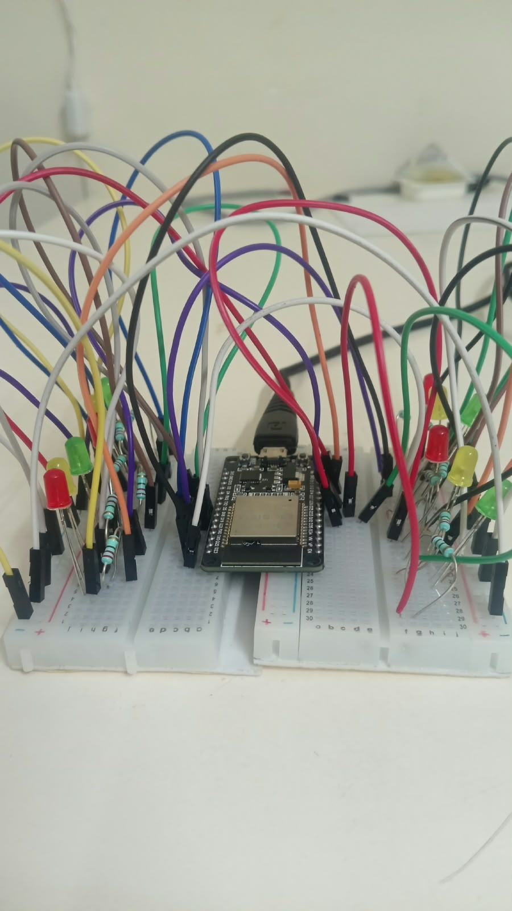
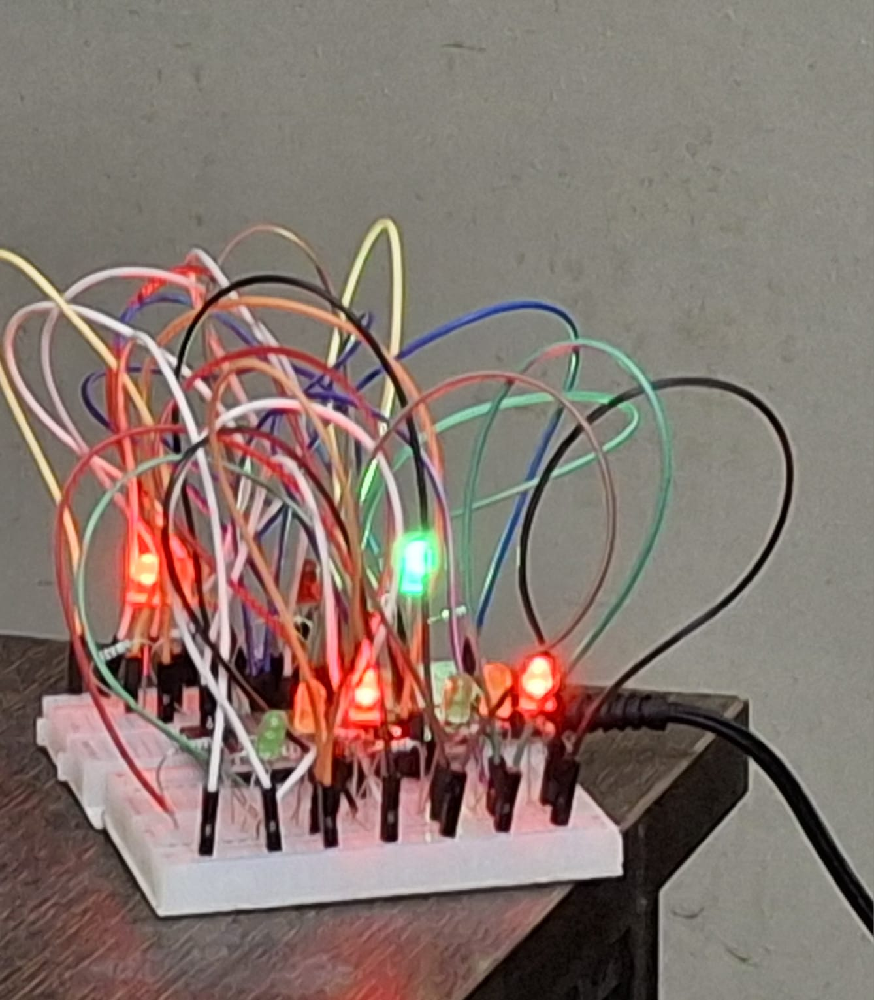

# RTVGS – Adaptive 4-Way Traffic Control

RTVGS is an adaptive traffic management system that uses camera or video input to detect vehicles and adjust traffic signal timings at a four-way intersection.

It combines YOLO-based vehicle detection, an adaptive traffic scheduler, a safety controller, a React dashboard, and ESP32-based traffic lights.

The project also supports mock mode for testing without a camera or hardware and optional SUMO integration for traffic simulation.

> **Note:** RTVGS is a prototype and is not certified for controlling public-road traffic.

## How It Works

```text
Camera / Video ──> YOLO ──> Vehicle Demand ──┐
Mock Traffic ────────────────────────────────┤
                                             v
React Dashboard <── WebSocket / REST <── FastAPI
                                             |
                              Scheduler + Safety Controller
                                      |              |
                                  ESP32 LEDs     SUMO (optional)
```

- **YOLO and OpenCV:** Detect vehicles from a camera or video.
- **Scheduler:** Calculates green signal duration based on traffic demand and waiting time.
- **Safety Controller:** Manages signal phases and prevents conflicting green lights.
- **FastAPI and WebSockets:** Send live updates to the dashboard.
- **ESP32:** Controls the 12 traffic signal LEDs.
- **SUMO:** Provides optional traffic simulation.

## Vehicle Detection and Traffic Demand

In YOLO mode, the system uses `yolo11n.pt` to detect cars, motorcycles, buses, and trucks. The default confidence threshold is `0.35`.

Each detected vehicle contributes to the weighted traffic demand of its assigned direction. Vehicle directions are estimated using the centre of their bounding boxes relative to the centre of the frame.

The system currently does not track individual vehicles or calculate actual queue lengths.

In mock mode, simulated traffic values are used instead of camera detections.

Vehicle weights are:

- Motorcycle: `0.5`
- Car: `1`
- Bus and truck: `2.5`

Traffic demand is calculated using a moving median followed by an exponential moving average (EMA):

```text
demand = median_5(weighted_vehicle_count)
filtered_demand = asymmetric_EMA(
    demand,
    lambda_up = 0.5,
    lambda_down = 0.2
)
```

The scheduler considers only directions with a minimum weighted demand of `0.5`.

Each eligible direction receives a priority score:

```text
priority = demand + 0.1 × waiting_age
```

Here, waiting age is the time elapsed since that direction last completed its green phase.

If a direction reaches 90 seconds of waiting age, it receives priority over other eligible directions. If multiple directions have equal priority, they are selected using round-robin ordering.

If no direction has sufficient traffic demand, the controller keeps all signals red.

Green time is calculated using:

```text
g_target = startup_lost_time + demand / (saturation_flow - arrival_rate)

green_time = clamp(round(g_target), MIN_GREEN, MAX_GREEN)
```

Initial configuration:

- Startup lost time: 2 seconds
- Saturation flow: 0.5 weighted demand units per second per effective lane
- Arrival rate: 20% of saturation flow (assumed initial value)
- Minimum green time: 8 seconds
- Maximum green time: 45 seconds
- Default effective lanes: 1 per direction

Effective lane counts can be configured separately for each direction.

Waiting time is estimated using the time an approach has traffic while its signal is not green. Individual vehicle waiting times are not tracked.

## Signal Control

The safety controller serves only one direction at a time and follows a fixed sequence:

```text
N_GREEN → N_YELLOW → ALL_RED
→ E_GREEN → E_YELLOW → ALL_RED
→ S_GREEN → S_YELLOW → ALL_RED
→ W_GREEN → W_YELLOW → ALL_RED
→ Repeat
```

Green duration changes according to traffic demand. Yellow and all-red durations are fixed at 3 seconds and 1 second by default.

The controller ensures that conflicting directions never receive green simultaneously.

Manual phase requests are queued and executed through the normal safety sequence. Stop requests also follow yellow and all-red transitions.

## Dashboard, ESP32 and SUMO

**React Dashboard**

- Displays live traffic demand and signal status.
- Allows users to start and safely stop the system.
- Supports manual green-phase requests.

**FastAPI Backend**

- Provides REST API endpoints.
- Sends live updates through WebSockets.
- Provides an annotated video stream in YOLO mode.

**ESP32 Hardware**

- Receives signal commands through USB serial at 115200 baud.
- Controls 12 LEDs representing the four traffic signals.
- Sends acknowledgements to the backend.
- Switches all signals to red if a command expires without a replacement.

Mock hardware mode is also available for testing without an ESP32.

**SUMO Simulation**

SUMO integration is optional. The backend uses TraCI to connect to the included `sumo/cross.sumocfg` file and update traffic signal phases.

SUMO is used only for traffic simulation. It does not provide camera detections or traffic demand to the scheduler.

## Technologies Used

- **Backend:** Python, FastAPI, Pydantic, asyncio
- **Vehicle Detection:** YOLO11n, OpenCV, NumPy
- **Dashboard:** React, TypeScript, Vite
- **Hardware:** ESP32, Arduino firmware, USB serial
- **Simulation:** SUMO, TraCI
- **Testing:** pytest

## Requirements

- Python 3.11+
- Node.js 20.19+ or 22.12+
- Vision mode: Packages listed in `backend/requirements-vision.txt`
- ESP32 mode: ESP32 board, Arduino IDE, and serial connection
- SUMO mode: SUMO, TraCI, and `SUMO_HOME` configured

## Installation and Run

The default configuration uses mock traffic and a mock ESP32 connection.

### Backend

**Windows PowerShell**

```powershell
cd backend
py -m venv .venv
.venv\Scripts\Activate.ps1
pip install -r requirements.txt
uvicorn app.main:app --reload
```

**macOS / Linux**

```bash
cd backend
python3 -m venv .venv
source .venv/bin/activate
pip install -r requirements.txt
uvicorn app.main:app --reload
```

Backend API documentation: http://localhost:8000/docs

### Dashboard

Open another terminal:

```bash
cd frontend
npm ci
npm run dev
```

Open http://localhost:5173 and select **Start system**.

To build the frontend:

```bash
npm run build
```

### Run Tests

From the `backend/` directory, with the virtual environment active:

```bash
pytest -q
```

## Optional Modes

### YOLO Camera or Video

From `backend/`, install the vision dependencies:

```bash
pip install -r requirements-vision.txt
```

Set `TRAFFIC_MODE=yolo` and `VIDEO_SOURCE=0` to use the webcam.

For a video, set `VIDEO_SOURCE` to its path, for example:

```text
../videos/intersection.mp4
```

The annotated video is available at:

http://localhost:8000/api/video.mjpg

### ESP32 Hardware

Set `SERIAL_MODE=serial` and configure `SERIAL_PORT` to the ESP32 port, such as `COM5` on Windows or `/dev/ttyUSB0` on Linux.

The default baud rate is `115200`.

Open `firmware/traffic_controller/traffic_controller.ino` in Arduino IDE, select your ESP32 board, and upload the firmware. Close Arduino Serial Monitor before starting the backend.

| Direction | Red GPIO | Yellow GPIO | Green GPIO |
|---|---:|---:|---:|
| North | 13 | 14 | 16 |
| South | 17 | 18 | 19 |
| East | 21 | 22 | 23 |
| West | 25 | 26 | 27 |

Use a series resistor for each LED and connect the grounds. Do not connect larger lamps directly to ESP32 GPIO pins.

### SUMO Simulation

Install SUMO and make sure its `tools` directory is available through `SUMO_HOME`.

Set:

- `SUMO_ENABLED=true` to enable simulation.
- `SUMO_GUI=true` to open the graphical interface.

## Configuration

Settings can be placed in a project-root `.env` file. See `.env.example` for all available options.

| Setting | Default | Purpose |
|---|---|---|
| `TRAFFIC_MODE` | `mock` | Mock traffic or YOLO detection |
| `VIDEO_SOURCE` | `0` | Webcam index or video path |
| `YOLO_MODEL` | `yolo11n.pt` | YOLO model file |
| `YOLO_CONFIDENCE` | `0.35` | Detection confidence threshold |
| `SERIAL_MODE` | `mock` | Mock or physical ESP32 connection |
| `SERIAL_PORT` | `COM5` | ESP32 serial port |
| `SERIAL_BAUD` | `115200` | Serial communication speed |
| `MIN_GREEN` / `MAX_GREEN` | `8` / `45` | Green-time limits in seconds |
| `STARTUP_LOST_TIME` | `2.0` | Startup lost time in seconds |
| `SATURATION_FLOW_PER_LANE` | `0.5` | Assumed saturation flow per lane |
| `ARRIVAL_RATE_FRACTION` | `0.2` | Assumed arrival rate fraction |
| `EFFECTIVE_LANES` | `1` | Default effective lanes per direction |
| `MIN_ELIGIBLE_DEMAND` | `0.5` | Minimum demand to select a direction |
| `MAX_PRIORITY_AGE_SECONDS` | `90` | Maximum waiting age for priority |
| `DEMAND_MEDIAN_SAMPLES` | `5` | Number of samples used for median |
| `DEMAND_LAMBDA_UP` / `DEMAND_LAMBDA_DOWN` | `0.5` / `0.2` | EMA smoothing coefficients |
| `YELLOW_SECONDS` | `3` | Yellow signal duration |
| `ALL_RED_SECONDS` | `1` | All-red duration |
| `FRONTEND_ORIGINS` | `http://localhost:5173` | Allowed frontend origins |
| `SUMO_ENABLED` | `false` | Enable SUMO |
| `SUMO_GUI` | `false` | Open SUMO graphical interface |
| `SUMO_CFG` | `sumo/cross.sumocfg` | SUMO configuration file |
| `SUMO_STEP_LENGTH` | `1.0` | Delay between SUMO simulation steps |

The dashboard uses `http://localhost:8000` for the backend by default. Set `VITE_API_URL` in `frontend/.env` to change it.

## API Endpoints

| Method | Path | Description |
|---|---|---|
| GET | `/health` | Backend health |
| GET | `/api/system` | Complete system status |
| GET | `/api/traffic` | Traffic measurements for each direction |
| GET | `/api/signals` | Current signal phases and colours |
| GET | `/api/history?limit=120` | Recent traffic history |
| POST | `/api/system/start` | Start the controller |
| POST | `/api/system/stop` | Request a safe stop |
| POST | `/api/manual/phase` | Request a manual green phase |
| WS | `/ws/live` | Live system updates |
| GET | `/api/video.mjpg` | Annotated video in YOLO mode |

Example manual phase request:

```json
{
  "phase": "N_GREEN",
  "duration": 15
}
```

## Limitations and Future Improvements

- No prerecorded intersection video is included. Camera positioning, stop-line locations, lane counts, and physical dimensions have not yet been calibrated.
- Camera calibration using surveyed ground points and perspective transformation can improve vehicle direction assignment.
- The system does not currently track vehicles or measure actual queue lengths and individual waiting times.
- Stop-line occupancy and vehicle discharge tracking are not implemented. Gap-out and discharge-based green extensions are future improvements.
- The current SUMO network is not mapped to real camera coordinates.
- Traffic history is stored in memory and is lost when the backend stops.
- User authentication is not currently implemented.
- Emergency vehicle and pedestrian signal phases are not implemented.
- The system has not been certified for real-road use.

Future improvements include camera calibration, vehicle tracking, database integration, user authentication, and support for emergency vehicles and pedestrians.

## Project Screenshots

<p align="center">
  
  
</p>